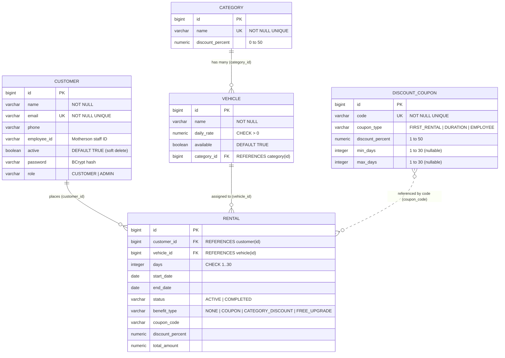

# Ryde.exe — Backend Architecture, Database Schema & Code Guide

This document explains the complete architecture of the Spring Boot backend (`server/carrental`), the PostgreSQL database schema (`database/schema.sql`), the request/security pipeline, how exceptions are handled, what every file in `server/` does, and a file-by-file walkthrough of the most important backend code blocks.

---

## 1. High-Level Architecture & Tech Stack

- **Framework:** Spring Boot 4 / Spring Web MVC (`spring-boot-starter-web`)
- **Persistence:** Spring Data JPA / Hibernate (`spring-boot-starter-data-jpa`)
- **Database:** PostgreSQL (`postgresql` driver) / H2 (`h2` for local dev/testing)
- **Security & JWT:** Spring Security + Spring OAuth2 Resource Server (`spring-boot-starter-security`, `spring-boot-starter-oauth2-resource-server`, Nimbus JOSE + JWT with `HmacSHA256`, `BCryptPasswordEncoder`)

### Layered Backend Architecture

```text
┌─────────────────────────────────────────────────────────────────────────┐
│ HTTP Request from React Frontend (with Authorization: Bearer <JWT>)     │
├─────────────────────────────────────────────────────────────────────────┤
│ 1. Security Filter Chain (SecurityConfig.java)                          │
│    CORS check → Stateless session → NimbusJwtDecoder validates HS256    │
│    signature & expiry → JwtAuthenticationConverter maps "role" claim    │
│    to ROLE_ADMIN / ROLE_CUSTOMER → URL/Method authorization check       │
├─────────────────────────────────────────────────────────────────────────┤
│ 2. REST Controllers (controller/*.java)                                 │
│    Parses path/query/body params, extracts Authentication principal,    │
│    and delegates to the Service layer                                   │
├─────────────────────────────────────────────────────────────────────────┤
│ 3. Business Service Layer (service/*.java)                              │
│    Enforces domain rules (dates, coupons, upgrades, role ownership),    │
│    manages @Transactional boundaries, throws domain exceptions          │
├─────────────────────────────────────────────────────────────────────────┤
│ 4. Data Access Layer (repository/*.java + entity/*.java)                │
│    Spring Data JPA derived queries → Hibernate → PostgreSQL tables      │
├─────────────────────────────────────────────────────────────────────────┤
│ 5. Global Exception Handler (exception/GlobalExceptionHandler.java)     │
│    @RestControllerAdvice catches any thrown exception and returns       │
│    clean JSON: { "error": "<message>" } with HTTP 400/401/403/404       │
└─────────────────────────────────────────────────────────────────────────┘
```

---

## 2. Database Schema & Entity-Relationship Design (`database/schema.sql`)

The relational schema in `server/carrental/database/schema.sql` consists of **5 core tables** and **4 performance indexes**:



### Detailed Table & SQL Constraint Breakdown (`database/schema.sql`)

```sql
CREATE TABLE IF NOT EXISTS category (
    id               BIGINT GENERATED BY DEFAULT AS IDENTITY PRIMARY KEY,
    name             VARCHAR(255)  NOT NULL UNIQUE,
    discount_percent NUMERIC(38,2) DEFAULT 0
        CHECK (discount_percent >= 0 AND discount_percent <= 50)
);

CREATE TABLE IF NOT EXISTS vehicle (
    id          BIGINT GENERATED BY DEFAULT AS IDENTITY PRIMARY KEY,
    name        VARCHAR(255)  NOT NULL,
    daily_rate  NUMERIC(38,2) NOT NULL CHECK (daily_rate > 0),
    available   BOOLEAN       NOT NULL DEFAULT TRUE,
    category_id BIGINT        NOT NULL REFERENCES category(id)
);

CREATE TABLE IF NOT EXISTS customer (
    id          BIGINT GENERATED BY DEFAULT AS IDENTITY PRIMARY KEY,
    name        VARCHAR(255) NOT NULL,
    email       VARCHAR(255) NOT NULL UNIQUE,
    phone       VARCHAR(255),
    employee_id VARCHAR(255),
    active      BOOLEAN      NOT NULL DEFAULT TRUE,
    password    VARCHAR(255),
    role        VARCHAR(255) NOT NULL DEFAULT 'CUSTOMER'
                CHECK (role IN ('CUSTOMER', 'ADMIN'))
);

CREATE TABLE IF NOT EXISTS discount_coupon (
    id               BIGINT GENERATED BY DEFAULT AS IDENTITY PRIMARY KEY,
    code             VARCHAR(255)  NOT NULL UNIQUE,
    coupon_type      VARCHAR(255)  NOT NULL
        CHECK (coupon_type IN ('FIRST_RENTAL', 'DURATION', 'EMPLOYEE')),
    discount_percent NUMERIC(38,2) NOT NULL
        CHECK (discount_percent > 0 AND discount_percent <= 50),
    min_days         INTEGER,
    max_days         INTEGER,
    CHECK (min_days IS NULL OR (min_days >= 1 AND max_days <= 30 AND min_days <= max_days))
);

CREATE TABLE IF NOT EXISTS rental (
    id               BIGINT GENERATED BY DEFAULT AS IDENTITY PRIMARY KEY,
    customer_id      BIGINT        NOT NULL REFERENCES customer(id),
    vehicle_id       BIGINT        NOT NULL REFERENCES vehicle(id),
    days             INTEGER       NOT NULL CHECK (days >= 1 AND days <= 30),
    start_date       DATE,
    end_date         DATE,
    status           VARCHAR(255)  CHECK (status IN ('ACTIVE', 'COMPLETED')),
    benefit_type     VARCHAR(255)  CHECK (benefit_type IN ('NONE', 'COUPON', 'CATEGORY_DISCOUNT', 'FREE_UPGRADE')),
    coupon_code      VARCHAR(255),
    discount_percent NUMERIC(38,2),
    total_amount     NUMERIC(38,2)
);
```

1. **`category` Table:**
   - Stores the 8 vehicle tiers (`Hatchback`, `Sedan`, `Compact SUV`, `SUV`, `MUV`, `Luxury`, `Electric`, `Convertible`).
   - `CHECK (discount_percent >= 0 AND discount_percent <= 50)` enforces category discount limits at the DB level.
2. **`vehicle` Table:**
   - Many-to-One foreign key `category_id REFERENCES category(id)` (`NOT NULL`). Because of this foreign key, PostgreSQL prevents deleting a category that still has vehicles assigned to it.
   - `CHECK (daily_rate > 0)` ensures positive pricing.
   - `available` tracks real-time lot status (`true` = available to rent, `false` = out on road).
3. **`customer` Table:**
   - Stores both `CUSTOMER` and `ADMIN` accounts (`CHECK (role IN ('CUSTOMER', 'ADMIN'))`).
   - `email` is `UNIQUE`.
   - `employee_id` stores the optional Motherson Employee ID (e.g., `MSN10000`) used to qualify for `EMPLOYEE` coupons (`MOTHERSON20`, `STAFF30`).
   - `active BOOLEAN NOT NULL DEFAULT TRUE` enables **soft deletion**: deactivating a customer flips `active = false` without breaking foreign-key references on historical rows in `rental`.
   - `password` stores the `BCrypt` hash.
4. **`discount_coupon` Table:**
   - `code` is `UNIQUE` and stored in uppercase.
   - `coupon_type` is constrained to `'FIRST_RENTAL'`, `'DURATION'`, or `'EMPLOYEE'`.
   - Table-level `CHECK (min_days IS NULL OR (min_days >= 1 AND max_days <= 30 AND min_days <= max_days))` guarantees valid duration bounds.
5. **`rental` Table:**
   - Foreign keys `customer_id REFERENCES customer(id)` and `vehicle_id REFERENCES vehicle(id)` prevent deleting a vehicle that has historical rentals.
   - Stores a denormalized snapshot of the applied offer (`benefit_type`, `coupon_code`, `discount_percent`, `total_amount`) so later edits to a coupon or category discount never alter past booking receipts.
6. **Database Indexes (`schema.sql` lines 65–68):**
   - `idx_vehicle_category ON vehicle(category_id)` — accelerates `GET /api/vehicles/category/{id}`.
   - `idx_vehicle_available ON vehicle(available)` — accelerates `GET /api/vehicles/available` and `FREE_UPGRADE` queries.
   - `idx_rental_customer ON rental(customer_id)` — accelerates `GET /api/rentals/my`, `GET /api/rentals/customer/{id}`, and `existsByCustomerId`.
   - `idx_rental_vehicle ON rental(vehicle_id)` — accelerates join and FK lookups on `vehicle_id`.

---

## 3. Complete File-by-File Inventory (`server/carrental`)

### Entry Point & Configuration (`config/`)
- **`CarrentalApplication.java`**: Main `@SpringBootApplication` class that boots the embedded Tomcat server on port `8080`.
- **`SecurityConfig.java`**: Configures stateless Spring Security with an OAuth2 Resource Server (`NimbusJwtDecoder` / `NimbusJwtEncoder` using HMAC-SHA256), `BCryptPasswordEncoder`, CORS, and endpoint authorization rules.
- **`CorsConfig.java`**: WebMvc CORS configuration for local development origins.
- **`AdminInitializer.java`**: `CommandLineRunner` that creates the default `ADMIN` account (`app.admin.email` / `app.admin.password`) if not already present.
- **`DataSeeder.java`**: `CommandLineRunner` that seeds the 8 categories, 78 vehicles, 7 discount coupons (`WELCOME50`, `WEEKEND10`, `WEEKLONG15`, `FORTNIGHT20`, `LONGHAUL25`, `MOTHERSON20`, `STAFF30`), sample customers, and initial rentals when the database is empty.

### Controllers (`controller/`)
- **`AuthController.java`**:
  - `POST /api/auth/register` → registers a new `CUSTOMER` account.
  - `POST /api/auth/login` → authenticates credentials and returns `AuthResponse(token, role, customerId, name)`.
- **`VehicleController.java`**:
  - `GET /api/vehicles`, `/available`, `/category/{categoryId}`, `/search?name=`, `/{id}`
  - `POST /api/vehicles`, `PUT /api/vehicles/{id}`, `DELETE /api/vehicles/{id}` (`ADMIN` only)
- **`CategoryController.java`**:
  - `GET /api/categories`, `/{id}`
  - `POST /api/categories`, `PUT /api/categories/{id}`, `DELETE /api/categories/{id}` (`ADMIN` only)
- **`DiscountCouponController.java`**:
  - `GET /api/coupons`, `/{id}`
  - `POST /api/coupons`, `PUT /api/coupons/{id}`, `DELETE /api/coupons/{id}` (`ADMIN` only)
- **`CustomerController.java`**:
  - `GET /api/customers`, `/{id}`, `POST /api/customers`, `PUT /api/customers/{id}`, `DELETE /api/customers/{id}` (`ADMIN` only; `DELETE` soft-deactivates the customer).
- **`RentalController.java`**:
  - `GET /api/rentals` (`ADMIN` only — all rentals)
  - `GET /api/rentals/my` (logged-in customer's own rentals via JWT `auth.getName()`)
  - `GET /api/rentals/{id}` (owner or `ADMIN`)
  - `GET /api/rentals/customer/{customerId}` (`ADMIN` only — specific customer's rental history)
  - `POST /api/rentals` (creates a rental for the authenticated customer; accepts `vehicleId`, `days`, optional `benefit`, optional `couponCode`, and optional `startDate`)
  - `PUT /api/rentals/{id}/return` (ends an active rental and marks the vehicle available again)

### Services (`service/`)
- **`AuthService.java`**: Registration (`BCrypt` password hashing, duplicate email check), login verification, and signed JWT generation (`JwtEncoder`).
- **`RentalService.java`**: Core booking engine (date window validation, single-benefit enforcement, coupon qualification rules, free-upgrade resolution, `BigDecimal` total calculation, and vehicle availability toggling).
- **`VehicleService.java`**: Vehicle CRUD, category resolution, availability updates, and `findUpgradeFor()`.
- **`CategoryService.java`**: Category CRUD and `0–50%` discount validation.
- **`DiscountCouponService.java`**: Coupon CRUD, uppercase code normalization, and type-specific validation (`FIRST_RENTAL` = 50%, `DURATION` = `minDays..maxDays`).
- **`CustomerService.java`**: Active customer listing, creation (forcing `Role.CUSTOMER`), profile updates, and soft-deactivation (`active = false`).

### Exceptions (`exception/`)
- **`GlobalExceptionHandler.java`**: `@RestControllerAdvice` that catches domain and security exceptions and returns `{ "error": "<message>" }`.
- **`VehicleNotFoundException.java`**, **`CategoryNotFoundException.java`**, **`CustomerNotFoundException.java`**, **`DiscountCouponNotFoundException.java`**, **`RentalNotFoundException.java`**: Domain `RuntimeException` classes mapped to `404 Not Found`.

### Entities, DTOs, Enums & Repositories
- **`entity/`**: `Customer.java`, `Vehicle.java`, `Category.java`, `DiscountCoupon.java`, `Rental.java`.
- **`dto/`**: Java records `LoginRequest.java`, `RegisterRequest.java`, `AuthResponse.java`.
- **`enums/`**: `Role.java`, `BenefitType.java`, `CouponType.java`, `RentalStatus.java`.
- **`repository/`**: `CustomerRepository.java`, `VehicleRepository.java`, `CategoryRepository.java`, `DiscountCouponRepository.java`, `RentalRepository.java`.
- **`resources/`**: `application.properties` (default config + JWT settings) and `application-postgres.properties` (PostgreSQL connection settings).

---

## 4. Exception Handling Pipeline (`exception/GlobalExceptionHandler.java`)

All exceptions across controllers and services are intercepted by **`GlobalExceptionHandler.java`** (`@RestControllerAdvice`), which returns a uniform JSON body `{ "error": "<message>" }`:

```java
@RestControllerAdvice
public class GlobalExceptionHandler {

    @ExceptionHandler(ResponseStatusException.class)
    public ResponseEntity<Map<String, String>> handleResponseStatus(ResponseStatusException ex) {
        return ResponseEntity.status(ex.getStatusCode())
                .body(Map.of("error", ex.getReason() != null ? ex.getReason() : "Request failed"));
    }

    @ExceptionHandler(AccessDeniedException.class)
    public ResponseEntity<Map<String, String>> handleAccessDenied(AccessDeniedException ex) {
        return ResponseEntity.status(HttpStatus.FORBIDDEN)
                .body(Map.of("error", ex.getMessage() != null ? ex.getMessage() : "Access denied"));
    }

    @ExceptionHandler(IllegalArgumentException.class)
    public ResponseEntity<Map<String, String>> handleBadRequest(IllegalArgumentException ex) {
        return ResponseEntity.status(HttpStatus.BAD_REQUEST)
                .body(Map.of("error", ex.getMessage()));
    }
    // + 404 handlers for CategoryNotFoundException, VehicleNotFoundException,
    //   CustomerNotFoundException, DiscountCouponNotFoundException, RentalNotFoundException
}
```

| Exception Class | Where It Is Thrown | HTTP Status | Example `"error"` Message |
| :--- | :--- | :--- | :--- |
| `IllegalArgumentException` | `RentalService`, `VehicleService`, `CategoryService`, `DiscountCouponService`, `CustomerService`, `AuthService` | **400 Bad Request** | `"Rental days must be between 1 and 30"`, `"Pick-up date cannot be in the past"`, `"This coupon is only for Motherson employees"` |
| `ResponseStatusException` | `AuthService.login` | **401 Unauthorized** | `"Invalid email or password"` |
| `AccessDeniedException` | `RentalController.requireAdmin`, `RentalService.checkOwner` | **403 Forbidden** | `"Admin only"`, `"This rental belongs to another customer"` |
| `*NotFoundException` | `getById` / `getByCode` in Services | **404 Not Found** | `"Vehicle not found with id: 99"` |

---

## 5. Deep-Dive: Important Backend Code Explained (File-by-File)

### 5.1 `config/SecurityConfig.java` — Stateless JWT Resource Server & Role Rules

```java
    // Reads the "role" claim from the token and turns ADMIN into ROLE_ADMIN
    private JwtAuthenticationConverter jwtAuthenticationConverter() {
        JwtGrantedAuthoritiesConverter authorities = new JwtGrantedAuthoritiesConverter();
        authorities.setAuthoritiesClaimName("role");
        authorities.setAuthorityPrefix("ROLE_");
        JwtAuthenticationConverter converter = new JwtAuthenticationConverter();
        converter.setJwtGrantedAuthoritiesConverter(authorities);
        return converter;
    }

    @Bean
    public SecurityFilterChain securityFilterChain(HttpSecurity http) throws Exception {
        http
            .cors(Customizer.withDefaults())
            .csrf(csrf -> csrf.disable())
            .sessionManagement(s -> s.sessionCreationPolicy(SessionCreationPolicy.STATELESS))
            .authorizeHttpRequests(auth -> auth
                    // Public
                    .requestMatchers("/api/auth/**", "/error").permitAll()
                    .requestMatchers(HttpMethod.OPTIONS, "/**").permitAll()

                    // Any logged-in user can browse
                    .requestMatchers(HttpMethod.GET, "/api/vehicles/**", "/api/categories/**", "/api/coupons/**").authenticated()

                    // Everything else on these is admin only (create, update, delete, coupons)
                    .requestMatchers("/api/vehicles/**", "/api/categories/**", "/api/coupons/**").hasRole("ADMIN")
                    .requestMatchers("/api/customers/**").hasRole("ADMIN")

                    // Rentals: only customers can rent, customer or admin can return, any logged-in user can read
                    .requestMatchers(HttpMethod.POST, "/api/rentals/**").hasRole("CUSTOMER")
                    .requestMatchers(HttpMethod.PUT, "/api/rentals/**").hasAnyRole("CUSTOMER", "ADMIN")
                    .requestMatchers(HttpMethod.GET, "/api/rentals/**").authenticated()

                    .anyRequest().authenticated())
            .oauth2ResourceServer(oauth -> oauth
                    .jwt(jwt -> jwt.jwtAuthenticationConverter(jwtAuthenticationConverter())));
        return http.build();
    }
```

**How this code works:**
1. **HMAC-SHA256 Symmetric Signing (`jwtEncoder` & `jwtDecoder`):** Uses the secret key from `app.jwt.secret` (`application.properties`) to sign tokens at login and verify them on every incoming request without needing an external OAuth server.
2. **Claim-to-Authority Mapping (`jwtAuthenticationConverter`):** Customizes Spring's converter to read the `"role"` claim (`"ADMIN"` or `"CUSTOMER"`) from the JWT and prefix it with `"ROLE_"`, enabling `.hasRole("ADMIN")` and `.hasRole("CUSTOMER")`.
3. **Top-to-Bottom Matcher Evaluation:**
   - `/api/auth/**` is open to everyone (`permitAll()`).
   - `GET` requests to `/api/vehicles/**`, `/api/categories/**`, and `/api/coupons/**` match first for any authenticated user, while `POST`/`PUT`/`DELETE` fall through to `.hasRole("ADMIN")`.
   - `POST /api/rentals/**` is restricted to `.hasRole("CUSTOMER")`, while `PUT /api/rentals/**` (returning a car) allows either `CUSTOMER` or `ADMIN`.

---

### 5.2 `service/AuthService.java` — Registration, BCrypt Verification & JWT Creation

```java
    public Customer register(RegisterRequest request) {
        if (request.password() == null || request.password().length() < 6) {
            throw new IllegalArgumentException("Password must be at least 6 characters");
        }
        Customer customer = new Customer();
        customer.setName(request.name());
        customer.setEmail(request.email());
        customer.setPhone(request.phone());
        customer.setEmployeeId(request.employeeId());

        // Validates, checks the email, and forces the role to CUSTOMER
        Customer saved = customerService.create(customer);
        saved.setPassword(passwordEncoder.encode(request.password()));
        return customerRepository.save(saved);
    }

    public AuthResponse login(LoginRequest request) {
        Customer customer = customerRepository.findByEmail(request.email())
                .filter(Customer::isActive)
                .filter(c -> c.getPassword() != null
                        && request.password() != null
                        && passwordEncoder.matches(request.password(), c.getPassword()))
                .orElseThrow(() -> new ResponseStatusException(
                        HttpStatus.UNAUTHORIZED, "Invalid email or password"));

        return new AuthResponse(createToken(customer), customer.getRole().name(),
                customer.getId(), customer.getName());
    }
```

**How this code works:**
- **Privilege Escalation Prevention (`register`):** Delegates creation to `customerService.create(customer)`, which forces `customer.setRole(Role.CUSTOMER)` and `customer.setActive(true)`, guaranteeing nobody can register themselves as an `ADMIN`. Then hashes the password with `BCryptPasswordEncoder`.
- **Deactivated Account Guard (`login`):** `.filter(Customer::isActive)` ensures that if an admin deactivates a customer (`DELETE /api/customers/{id}`), that customer can no longer sign in.
- **JWT Claims (`createToken`):** Sets `sub` (subject) to `customer.getEmail()` and embeds `"role"` and `"customerId"` claims with a 120-minute expiration (`app.jwt.expiry-minutes`).

---

### 5.3 `controller/RentalController.java` — Principal Extraction & Role Checks

```java
	// The customer comes from the token, not from the request.
	// startDate is optional (format yyyy-MM-dd); if missing, the rental starts today.
	@PostMapping
	public ResponseEntity<Rental> rent(@RequestParam Long vehicleId, @RequestParam int days,
			@RequestParam(required = false) BenefitType benefit, @RequestParam(required = false) String couponCode,
			@RequestParam(required = false) @DateTimeFormat(iso = DateTimeFormat.ISO.DATE) LocalDate startDate,
			Authentication auth) {
		Rental rental = rentalService.rent(auth.getName(), vehicleId, days, benefit, couponCode, startDate);
		return ResponseEntity.status(HttpStatus.CREATED).body(rental);
	}
```

**How this code works:**
- `POST /api/rentals` **does not accept a `customerId` parameter** from the client. Instead, it extracts `auth.getName()` (the verified email subject inside the signed JWT). This prevents a user from spoofing another customer's identity when creating a booking.
- `@DateTimeFormat(iso = DateTimeFormat.ISO.DATE) LocalDate startDate` parses the optional `YYYY-MM-DD` pick-up date parameter.

---

### 5.4 `service/RentalService.java` — Booking Engine, Coupons, Free Upgrade & Pricing

```java
	@Transactional
	public Rental rent(String email, Long vehicleId, int days, BenefitType benefit, String couponCode,
			LocalDate startDate) {
		if (days < 1 || days > MAX_DAYS) {
			throw new IllegalArgumentException("Rental days must be between 1 and " + MAX_DAYS);
		}

		// Pick-up date: today by default, or up to MAX_ADVANCE_DAYS ahead
		LocalDate today = LocalDate.now();
		LocalDate start = (startDate == null) ? today : startDate;
		if (start.isBefore(today)) {
			throw new IllegalArgumentException("Pick-up date cannot be in the past");
		}
		if (start.isAfter(today.plusDays(MAX_ADVANCE_DAYS))) {
			throw new IllegalArgumentException("Pick-up date can be at most " + MAX_ADVANCE_DAYS + " days ahead");
		}
```

**How the Booking Engine works step-by-step:**
1. **Atomicity (`@Transactional`):** Saving the `Rental` row and flipping the vehicle's availability (`vehicleService.setAvailable(rentedVehicle.getId(), false)`) execute inside a single database transaction. If any check fails, everything rolls back.
2. **Date Window Validation:** Enforces `1 <= days <= 30` (`MAX_DAYS`) and `today <= start <= today + 30 days` (`MAX_ADVANCE_DAYS`).
3. **Single-Benefit Switch (`switch (type)`):**
   - `COUPON`: Calls `findEligibleCoupon(couponCode, customer, days)`:
     - `FIRST_RENTAL`: Checks `rentalRepository.existsByCustomerId(customer.getId())`. If `true`, throws `"First-rental discount is only for a customer's first rental"`.
     - `DURATION`: Verifies `days >= coupon.getMinDays() && days <= coupon.getMaxDays()`.
     - `EMPLOYEE`: Verifies `customer.getEmployeeId()` is non-null and non-blank. (Unlike `FIRST_RENTAL`, `EMPLOYEE` coupons have no `existsByCustomerId` check, making them **reusable across multiple bookings**).
   - `CATEGORY_DISCOUNT`: Reads `selected.getCategory().getDiscountPercent()` and throws if `0%`.
   - `FREE_UPGRADE`: Calls `vehicleService.findUpgradeFor(selected)` to assign a higher-rate available car from another category (`rentedVehicle`), while **calculating the price using `selected.getDailyRate()`** so the customer gets the upgraded car at the original car's daily rate.
4. **Exact Decimal Arithmetic (`calculateTotal`):**
   ```java
   private BigDecimal calculateTotal(BigDecimal dailyRate, int days, BigDecimal discountPercent) {
       BigDecimal gross = dailyRate.multiply(BigDecimal.valueOf(days));
       BigDecimal discount = gross.multiply(discountPercent).divide(BigDecimal.valueOf(100), 2, RoundingMode.HALF_UP);
       return gross.subtract(discount).setScale(2, RoundingMode.HALF_UP);
   }
   ```
   Uses `BigDecimal` with `RoundingMode.HALF_UP` (2 decimal places) so currency calculations never suffer from floating-point precision loss.

---

### 5.5 `service/VehicleService.java` & `repository/VehicleRepository.java` — Smart Free Upgrade Query

```java
	// Cheapest available vehicle in another category that costs more than this one
	public Vehicle findUpgradeFor(Vehicle vehicle) {
		return vehicleRepository
				.findByAvailableTrueAndCategoryIdNotAndDailyRateGreaterThanOrderByDailyRateAsc(
						vehicle.getCategory().getId(), vehicle.getDailyRate())
				.stream().findFirst()
				.orElseThrow(() -> new IllegalArgumentException("No upgrade vehicle is available"));
	}
```

**How this code works:**
- Uses Spring Data JPA's derived query method in `VehicleRepository.java`, which Hibernate translates into:
  ```sql
  SELECT * FROM vehicle
  WHERE available = true
    AND category_id <> ?
    AND daily_rate > ?
  ORDER BY daily_rate ASC
  ```
- Taking `.stream().findFirst()` selects the next step up in price from a different category, or throws `"No upgrade vehicle is available"` (HTTP 400) if no higher-priced car is available.

---

### 5.6 `service/DiscountCouponService.java` — Coupon Rule Validation

```java
		if (coupon.getCouponType() == CouponType.FIRST_RENTAL && percent.compareTo(new BigDecimal("50")) != 0) {
			throw new IllegalArgumentException("First-rental discount must be exactly 50%");
		}

		if (coupon.getCouponType() == CouponType.DURATION) {
			Integer min = coupon.getMinDays();
			Integer max = coupon.getMaxDays();
			if (min == null || max == null) {
				throw new IllegalArgumentException("Duration coupon needs minDays and maxDays");
			}
			if (min < 1 || max > 30 || min > max) {
				throw new IllegalArgumentException("Duration coupon days must satisfy 1 <= minDays <= maxDays <= 30");
			}
		} else {
			coupon.setMinDays(null);
			coupon.setMaxDays(null);
		}
```

**How this code works:**
- Normalizes every coupon code to uppercase (`coupon.setCode(coupon.getCode().trim().toUpperCase())`).
- Enforces that `FIRST_RENTAL` coupons are always `50%`.
- Enforces that `DURATION` coupons specify a valid `1 <= minDays <= maxDays <= 30` range, and clears `minDays` / `maxDays` to `null` for `FIRST_RENTAL` and `EMPLOYEE` coupons.

---

### 5.7 `entity/Customer.java` — Protecting Password Hashes in JSON

```java
    // Stored as a BCrypt hash. WRITE_ONLY: accepted in requests, never sent back.
    @JsonProperty(access = JsonProperty.Access.WRITE_ONLY)
    private String password;
```

**How this code works:**
- Because `RentalController` and `CustomerController` return `Customer` entities directly in JSON responses (`r.customer` on bookings and `/api/customers` in the Admin console), `@JsonProperty(access = JsonProperty.Access.WRITE_ONLY)` instructs Jackson to allow deserializing `password` when reading a request, but **never serialize `password` into any outgoing JSON response**.
